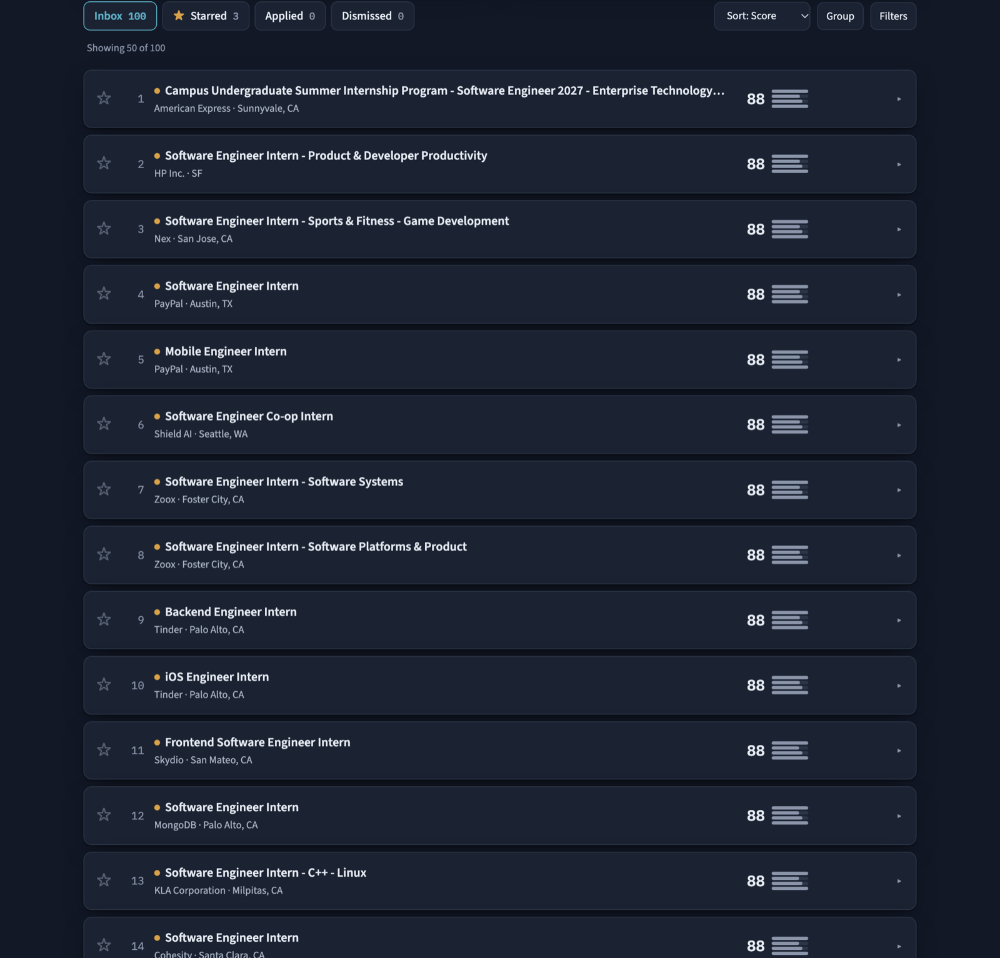
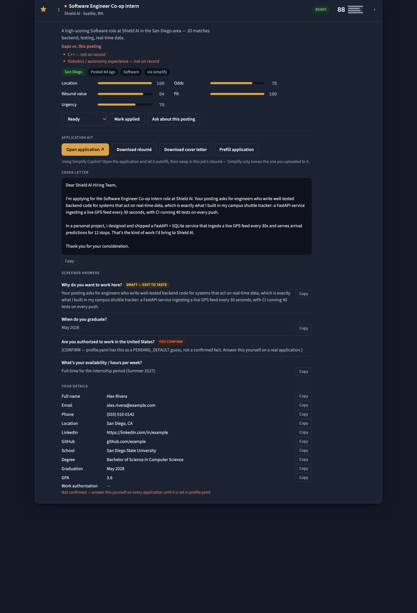
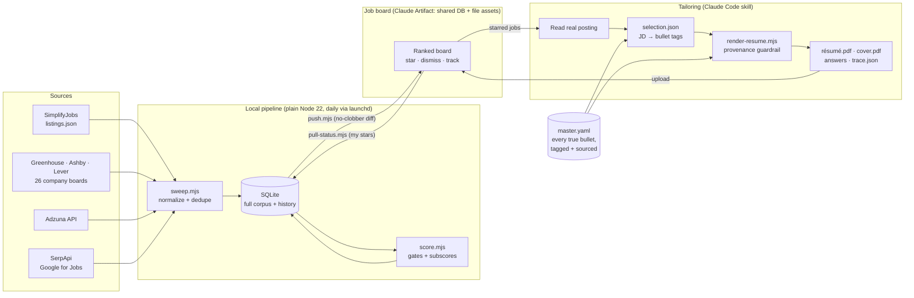

# job-hunt-agent

**An automated internship and part-time job search that finds postings across four kinds of sources, ranks them with an explainable score, and builds a tailored, fact-checked application kit for each job I choose — while I always press Submit myself.**


<p align="center">
  
  
</p>

I built this for my own Summer 2027 internship search (plus part-time work near campus). It runs every morning, tracks **5,000+ postings** across a community internship list, 26 company career boards, Adzuna, and Google for Jobs, and keeps a ranked board of the ~1,900 that are open and in scope. When I star a job, a tailoring pass reads the real job description and assembles a one-page résumé, cover letter, and screener answers **chosen only from facts I have verified** — the build fails if any line can't be traced to its source.

> The screenshots use real public job listings and a **fictional candidate ("Alex Rivera")** — the same example data this repo ships with, so you can run everything without touching anyone's personal information.

---

## What it does

| Stage | What happens | Where |
|---|---|---|
| **Discover** | Pulls postings from the SimplifyJobs internship list, Greenhouse / Ashby / Lever boards, Adzuna, and SerpApi's Google for Jobs (the only route to Indeed and LinkedIn listings — neither is ever scraped). Deduplicates across sources. | [`sweep.mjs`](scripts/sweep.mjs) |
| **Rank** | Hard gates (term, degree, US-only, commute, seniority), then weighted, explainable subscores: odds, résumé value, fit, urgency, location (internships) or pay, commute, odds, résumé value (part-time). Every number is shown on the board. | [`score.mjs`](scripts/score.mjs), [`derive.mjs`](scripts/lib/derive.mjs) |
| **Review** | A live board (star, dismiss, filter by region / role / pay / distance, track applications through interview and offer). | [`board/board.html`](board/board.html) |
| **Tailor** | For starred jobs: read the posting, match its requirements to tagged résumé bullets, render an ATS-safe PDF résumé + cover letter + drafted answers, and upload the kit to the board. | [`render-resume.mjs`](scripts/render-resume.mjs), [`jobs-tailor`](.claude/skills/jobs-tailor/SKILL.md) |
| **Apply** | One click opens the employer's application; every field I need is a click-to-copy away. Optional prefill fills the form in my own browser and stops before Submit. | [`jobs-prefill`](.claude/skills/jobs-prefill/SKILL.md) |

## Architecture



More detail: [docs/architecture.md](docs/architecture.md).

## Engineering decisions worth calling out

**Selection, never invention — enforced, not promised.** `resume/master.yaml` is a library of every bullet I could truthfully use, each with an id, skill tags, alternate phrasings of the *same* fact, and a note on where it was verified. Tailoring only *chooses* among them (a new phrasing can be added, but only as a variant of an already-verified bullet). `render-resume.mjs` records the source id of every rendered line in `trace.json` and **throws before writing any file** if a line has no valid id — a test proves it ([`test/render.test.mjs`](test/render.test.mjs)). Facts that are only placeholders (e.g. work authorization I haven't confirmed) are flagged `[CONFIRM]` in drafted answers instead of being stated, and a cover letter that would need an invented "why this company" line keeps a visible `[TODO]` and gets no PDF.

**Responsible automation.** It never submits an application, never creates accounts, never answers demographic questions, and never automates LinkedIn or Indeed directly (account-ban risk; Google for Jobs returns the same postings legitimately). API usage is capped by per-source daily budgets persisted in SQLite, so a bad loop can't burn a month's free quota.

**Sync that can't destroy my work.** The board owns my decisions (stars, statuses, packages); the pipeline owns scores. `push.mjs` only `set`s brand-new documents, sends score-only updates to existing ones (diffed with a drift tolerance so daily urgency changes don't rewrite 2,000 docs), and deletes a stale posting only if I never touched it. `pull-status.mjs` never lets a board value undo a scorer gate.

**Rankings that move for the right reason.** Location started as a small additive bonus and left zero San Diego jobs in my top 43. It is now a weighted subscore (30%) with a region model that understands real location strings — "SF", "Remote in UK", "San Marcos, TX" vs "San Marcos, CA", multi-city postings — covered by tests.

**Bugs found by checking real data, not assumptions** (each is fixed and noted in the code where it lives):
- Adzuna reports *predicted* salaries and labels hourly pay as yearly → pay is interpreted by magnitude, predictions ignored.
- `new Date("2028-05")` printed "April 2028" on a résumé in Pacific time → string-based month formatting.
- A headless Chrome render that hung was still alive 40 days later and stalled every later render → SIGKILL timeout, throwaway profile per render, retry, stale-PDF deletion.
- A Google search share-link was being stored as the "apply" URL → the employer's own link is preferred, aggregators only when they name the company.

## Quick start (demo mode)

Requires **Node 22.5+** and Google Chrome (used headless to print PDFs).

```bash
git clone https://github.com/jeremystuit13/job-hunt-agent.git
cd job-hunt-agent
npm ci
npm test                      # 14 tests, incl. a real PDF render for the example candidate

npm run sweep                 # free sources work without keys (SimplifyJobs + company boards)
npm run score                 # rank everything; prints the top 10 per track
```

With no personal config present, every script falls back to `profile.example.yaml` and `resume/master.example.yaml` (the fictional candidate) and says so.

## Using it for yourself

1. `cp profile.example.yaml profile.yaml` — school, target term, commute origin, pay floor, scoring weights.
2. `cp resume/master.example.yaml resume/master.yaml` — your bullets, tags, variants and default layouts.
3. `cp .env.example .env` — optional free API keys for Adzuna and SerpApi (budgets are enforced).
4. `schedule/install.sh` — optional daily 07:30 sweep + score on macOS.

All four personal files are gitignored. Build a package for any job with `npm run tailor -- <job-id>`.

The board itself is a [Claude Artifact](https://claude.ai) (a hosted page with a shared database and file storage); syncing it and the tailoring pass run as Claude Code skills in [`.claude/skills/`](.claude/skills). The discovery, scoring and rendering pipeline is plain Node and runs without Claude.

## Project layout

```
scripts/
  sweep.mjs          multi-source discovery, normalization, dedupe, quota gates
  score.mjs          hard gates + weighted subscores + one-line rationale per job
  render-resume.mjs  résumé / cover letter / answers with the provenance guardrail
  push.mjs           no-clobber diff of the ranked corpus → board writes
  pull-status.mjs    board decisions → local DB
  build-board.mjs    bakes a first-paint snapshot into the board page
  profile-doc.mjs    "your details" panel for the application kit
  lib/               db (SQLite + dedupe keys), derive (shared facts), util, config
board/board.html     the job board (single file, no build step)
resume/              master.example.yaml (bullet library) + ATS-safe template
.claude/skills/      sweep / tailor / prefill / handshake workflows
schedule/            launchd daily job
test/                node:test suite, run in CI
```

## Tests

```bash
npm test
```

Covers the provenance guardrail (a fabricated bullet id must fail the build and write nothing), an end-to-end render, cross-source dedupe keys, location tiering, pay interpretation, role grouping, and apply-link selection. CI runs them on every push with the example candidate.

## Limitations and roadmap

- Location and commute logic is tuned for a San Diego / California search (regions live in [`derive.mjs`](scripts/lib/derive.mjs)).
- Fit is category-only for the ~97% of postings whose source carries no description; real job-description matching happens at tailoring time.
- Planned: learn from dismissals to down-rank similar roles; cheaper incremental board sync; Handshake integration through the browser.

## License

[MIT](LICENSE) © 2026 Jeremy Stuit
